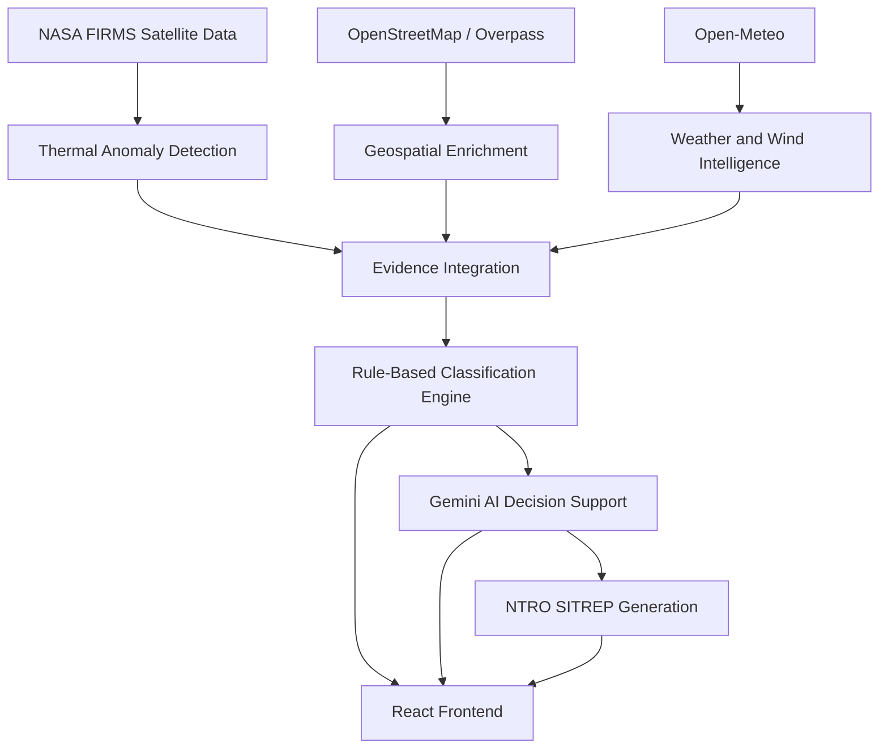

# 🔥 NTRO ThermalPulse
### Turning Satellite Thermal Anomalies into Actionable Intelligence

An AI-powered industrial fire detection and monitoring system that uses satellite thermal anomaly data, geospatial intelligence, weather information, and generative AI to identify, classify, and analyze potential industrial fire hazards.

---

## 📌 Problem Statement

**AI-Based Detection and Classification of Industrial Fires and Persistent Thermal Sources Using NASA FIRMS, OSM & Satellite Data**

Industrial fires and persistent thermal anomalies can pose serious risks to human lives, infrastructure, and the environment. Early identification and contextual analysis of these anomalies are essential for effective disaster monitoring and response.

ThermalPulse aims to transform satellite-based thermal observations into actionable intelligence by combining real-time fire data, geospatial enrichment, weather conditions, rule-based classification, and AI-powered decision support.

---

## 🎯 Project Objectives

- Detect thermal anomalies using NASA FIRMS satellite observations.
- Identify potential industrial fire locations using geospatial context.
- Enrich detected anomalies with nearby infrastructure and facility information.
- Incorporate weather and wind conditions for contextual analysis.
- Classify thermal anomalies into meaningful categories.
- Generate AI-powered decision-support insights and situation reports.
- Improve situational awareness for disaster monitoring and response teams.

---

## ✨ Key Features

### 🛰️ 1. Live Satellite Thermal Monitoring
- Fetches real satellite thermal anomaly observations from NASA FIRMS.
- Uses satellite fire detection data for monitoring potential fire events.
- Displays detected anomalies through the application's geospatial interface.

### 🏭 2. Geospatial Intelligence
- Integrates OpenStreetMap data through the Overpass API.
- Enriches anomalies with nearby infrastructure and industrial facility context.
- Helps identify potentially vulnerable locations surrounding detected thermal sources.

### 🌦️ 3. Weather Intelligence
- Integrates Open-Meteo weather data.
- Retrieves current weather and wind information.
- Provides additional environmental context for anomaly assessment.

### 🧠 4. Rule-Based Anomaly Classification
Uses an evidence-based heuristic engine to classify detected thermal anomalies into categories such as:

- `COAL_MINING_FIRE`
- `INDUSTRIAL_FIRE`
- `POWER_PLANT_THERMAL`
- `URBAN_OTHER`

The classification engine uses available thermal and geospatial evidence to support categorization.

### 🤖 5. Gemini AI Decision Support
- Integrates Google Gemini API.
- Generates contextual AI-powered analysis using available anomaly evidence.
- Provides decision-support insights to help interpret detected events.
- Uses fallback responses when the Gemini API is unavailable or its quota is exhausted.

### 📄 6. NTRO SITREP Generation
- Generates structured Situation Reports (SITREPs).
- Summarizes detected anomalies and supporting evidence.
- Presents AI-generated operational insights when Gemini is available.

### 🔍 7. Data Provenance
- Maintains visibility into the sources of information used during analysis.
- Distinguishes live external data, rule-based outputs, and AI-generated or fallback content.

---

## ⚙️ System Architecture



---

## 🔄 How ThermalPulse Works

1. **Data Collection:** Retrieves satellite thermal anomaly observations from NASA FIRMS.
2. **Anomaly Processing:** Processes the retrieved observations for further analysis.
3. **Geospatial Enrichment:** Uses OpenStreetMap and Overpass API to identify nearby infrastructure and industrial context.
4. **Weather Enrichment:** Retrieves current weather and wind information through Open-Meteo.
5. **Classification:** Applies the rule-based heuristic engine to categorize detected anomalies.
6. **AI Analysis:** Sends relevant evidence to Google Gemini for decision-support synthesis when requested and available.
7. **Situation Reporting:** Generates an NTRO SITREP containing a structured summary of the analysis.
8. **Visualization:** Presents the results through the ThermalPulse frontend.

---

## 🛠️ Technology Stack

| Category | Technologies |
|---|---|
| Frontend | React, Vite, TypeScript |
| Backend | Node.js, Express.js, TypeScript |
| Satellite Data | NASA FIRMS |
| Geospatial Data | OpenStreetMap, Overpass API |
| Weather Data | Open-Meteo |
| AI Integration | Google Gemini API |
| Classification | Rule-Based Heuristic Engine |
| Development Tools | Git, GitHub, VS Code |

---

## 🌐 External Data Sources and APIs

| Source | Purpose |
|---|---|
| [NASA FIRMS](https://firms.modaps.eosdis.nasa.gov/) | Satellite-based fire and thermal anomaly observations |
| [OpenStreetMap](https://www.openstreetmap.org/) | Geographic and infrastructure information |
| [Overpass API](https://overpass-api.de/) | Retrieval of relevant OpenStreetMap features |
| [Open-Meteo](https://open-meteo.com/) | Weather and wind information |
| [Google Gemini](https://ai.google.dev/) | AI-powered analysis and situation report generation |

---

## 🧠 Classification Categories

ThermalPulse currently uses a rule-based classification engine.

| Category | Description |
|---|---|
| `COAL_MINING_FIRE` | Thermal anomalies associated with coal mining areas |
| `INDUSTRIAL_FIRE` | Anomalies with industrial facility context |
| `POWER_PLANT_THERMAL` | Thermal anomalies associated with power generation facilities |
| `URBAN_OTHER` | Other anomalies associated with urban or surrounding areas |

**Note:** These classifications are heuristic assessments based on available evidence. They should not be interpreted as confirmed fire incidents.

---

## 🤖 AI Decision Support

ThermalPulse integrates Google Gemini to generate contextual analysis based on the available evidence.

The AI components include:

- **NTRO AI Decision-Support Synthesis:** Generates contextual analysis of detected anomalies.
- **NTRO SITREP:** Produces structured situation reports for operational awareness.

Gemini-generated content is distinguished from fallback responses. If the API is unavailable or the free-tier quota is exhausted, the application uses its existing fallback mechanism.

---

## 📂 Project Structure

The project follows a React + Vite + TypeScript frontend and Express + TypeScript backend architecture.

```text
ThermalPulse/
│
├── src/
│   ├── components/
│   ├── utils/
│   │   └── geoUtils.ts
│   ├── data/
│   │   └── mockGeospatialData.ts
│   └── App.tsx
│
├── backend/
│   ├── services/
│   │   ├── firmsService.ts
│   │   └── geminiService.ts
│   ├── routes/
│   │   └── geminiRoutes.ts
│   ├── config/
│   │   └── env.ts
│   └── server.ts
│
├── .env.example
├── package.json
└── README.md
```

*Note: This is a representative overview of the main project components. Refer to the repository for the complete directory structure.*

---

## 🚀 Getting Started

### Prerequisites

Make sure you have the following installed:

- Node.js
- npm
- Git
- A NASA FIRMS API key
- A Google Gemini API key

### 1. Clone the Repository

```bash
git clone https://github.com/ACE-TRYING/ThermalPulse.git
```

Replace the repository URL above if your GitHub repository uses a different name.

### 2. Navigate to the Project

```bash
cd ThermalPulse
```

### 3. Install Dependencies

```bash
npm install
```

### 4. Configure Environment Variables

Create a `.env.local` file in the project root.

Add your API credentials:

```env
GEMINI_API_KEY=your_gemini_api_key
GEMINI_MODEL=gemini-3.6-flash
FIRMS_MAP_KEY=your_nasa_firms_map_key
```

Use the variable names required by your existing configuration. Never commit actual API keys or secret credentials to GitHub.

### 5. Start the Development Server

```bash
npm run dev
```

Open the local application using the address printed in your terminal.

**Important:** Check the existing `package.json` for the exact scripts and the repository's environment configuration before running these commands.

---

## 🔌 Backend API Endpoints

The following endpoints are part of the existing backend implementation:

| Method | Endpoint | Purpose |
|---|---|---|
| GET | `/api/health` | Backend health check |
| POST | `/api/firms/fetch-live` | Fetch live NASA FIRMS observations |
| POST | `/api/gemini/classify-analyze` | AI-assisted anomaly analysis |
| POST | `/api/gemini/tactical-brief` | Generate AI tactical brief / SITREP |

Additional geospatial and weather integrations are handled by the backend services.

---

## 🧪 Testing and Validation

The project has undergone validation of its major data and backend components.

Testing areas include:

- NASA FIRMS live data retrieval.
- Satellite CSV parsing.
- OpenStreetMap enrichment.
- Weather and wind data retrieval.
- Rule-based anomaly classification.
- Gemini API integration and fallback handling.
- Backend API endpoint responses.
- TypeScript validation and production build.

---

## ⚠️ Limitations

- Satellite thermal observations do not independently confirm an industrial fire.
- Geospatial enrichment depends on the availability and accuracy of OpenStreetMap data.
- Overpass API availability and response times may vary.
- Weather information depends on external API availability.
- Rule-based classifications are preliminary assessments, not verified incident classifications.
- Gemini AI generation depends on API availability and applicable usage quotas.
- The system is intended as a decision-support prototype, not a replacement for official emergency response systems.

---

## 🔮 Future Enhancements

- Historical thermal anomaly analysis.
- Persistent anomaly tracking across satellite observations.
- Advanced machine-learning-based anomaly classification.
- Improved industrial facility identification.
- Multi-source satellite data integration.
- Risk scoring and alert prioritization.
- Enhanced incident visualization and reporting.
- Historical event analytics and trend detection.

---

## 🙌 Acknowledgements

This project builds upon publicly available data and technologies provided by:

- NASA Fire Information for Resource Management System (FIRMS)
- OpenStreetMap contributors
- Overpass API
- Open-Meteo
- Google Gemini

Special acknowledgement to the developers and open-source communities behind the technologies used in this project.

---

## 👨‍💻 Project Information

**Project Name:** NTRO ThermalPulse

**Domain:** Artificial Intelligence, Geospatial Intelligence, Satellite Data Analysis, Disaster Management

**Problem Statement:** AI-Based Detection and Classification of Industrial Fires and Persistent Thermal Sources Using NASA FIRMS, OSM & Satellite Data.

**Developed as:** Smart India Hackathon (SIH) project prototype.

---

<p align="center">
  <b>ThermalPulse — Detect. Classify. Analyze. Respond.</b>
</p>
